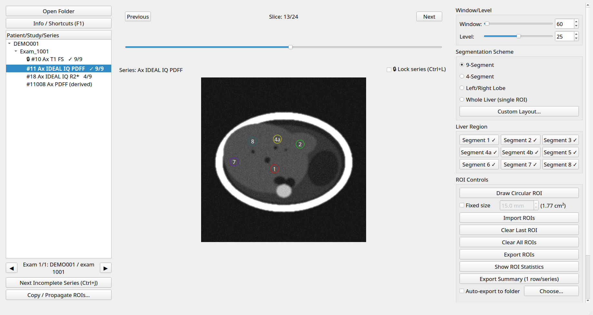

# Liver ROI Tool
A Python application for drawing and exporting ROI statistics, primarily intended for quantitative liver MRI. The application provides tools for visualizing DICOM series, drawing circular ROIs, assigning liver segments, and exporting summary statistics.



## To-Do List
- [x] Open folder, browse DICOM files
- [x] Change window width/level
- [x] Keyboard and mouse shortcuts
- [x] Add and remove ROIs
- [x] Export ROI statistics to CSV
- [x] Switch between 9-segment, 4-segment, left/right lobe, and whole-liver ROI schemes
- [x] Copy ROIs between series (registered)
- [x] Copy ROIs between series (unregistered)
- [x] Propagate ROIs to all / selected series in an exam
- [x] Load stored ROIs from a file
- [X] Verify ROI mean / median accuracy (with Horos, MATLAB, etc)
        - Accuracy verified with Horos
- [ ] AI implementation to estimate ROIs

## Features
- DICOM Browser: Navigate patient/study/series hierarchy
- Series Viewer: Display DICOM images with customizable window/level settings
- Image Navigation: Scroll through slices using buttons, keyboard, mouse wheel, or slice slider
- ROI Tools: Draw circular ROIs (drag, or click to place a fixed-diameter ROI) and associate them with liver segments; drag an ROI to move it or its edge to resize it
- Segmentation Schemes: 9-segment (Couinaud), 4-segment, left/right lobe, or a single whole-liver ROI
- ROI Statistics: Calculate and display statistics (mean, median, min, max, size) for each ROI, using rescaled pixel values (RescaleSlope/Intercept)
- Zoom/Pan and Cursor Readout: zoom at the cursor, pan, and see pixel value and patient position (mm) under the cursor
- Autosave: unexported ROIs are autosaved per folder and offered for restore when the folder is reopened; closing with unexported ROIs asks first
- Export Capabilities: Export ROIs and statistics to CSV files, including std, ROI scheme, and series/acquisition info (series number/date/time, scanner, TR/TE/flip angle, slice thickness, etc.)
- Summary Export: one row per series with Mean/Median/Std/Area/Slice columns per segment
- Import: Load ROIs from any exported CSV (including older versions) into every matching series in the opened folder (matched by Series UID), replacing or merging with existing ROIs; the segmentation scheme switches automatically to match
- ROI Copy / Propagate: Copy ROIs from the current series to all or selected series in the same exam, or into the current series from another series, matched by anatomical position (axial, coronal, sagittal, or oblique)

## Requirements
- Python 3.6+
- PyQt5
- pydicom
- NumPy

## Installation
1. Clone the repository:
```bash
git clone https://github.com/yourusername/liver-mri-viewer.git
cd liver-mri-viewer
```
2. Install dependencies:
```bash
pip install -r requirements.txt
```

## Usage
1. Run the application:
```bash
python liver-app.py
```
2. Click "Open Folder" to select a directory containing DICOM data (`.dcm` / `.sdcopen` by default; see Advanced Settings)
3. Navigate the directory tree and select a series to load. Series are listed as `#SeriesNumber Description`, with ROI progress (e.g. `5/9`, `✓ 9/9`)
4. Adjust window/level using right-click and drag
5. Draw ROIs by:
- Toggling "Draw Circular ROI" button
- Left-clicking at the ROI center and dragging out to the desired radius, or enabling "Fixed size" and clicking to place an ROI of that diameter
- Selecting a liver segment
6. To reuse ROIs on other series, click "Copy / Propagate ROIs...", check the target series (or Select All), and click "Copy ROIs". A summary lists ROIs copied or skipped per series (e.g. different orientation, no slice within the max distance)
7. Export ROIs for all series at once with "Export ROIs" (Ctrl+S)

## ROI Checklist
The table under the ROI controls lists every segment of the current scheme for the current series, with its slice and statistics (`—` = not drawn yet, bold = on the current slice). Double-click a row to jump to that slice. Segment buttons show ✓ once drawn. Import/export/copy results appear in the status bar.

## Advanced Settings
`liver_roi_config.json` is created next to the app on first run:
```json
{
    "dicom_extensions": [".dcm", ".sdcopen"],
    "scan_all_files": false
}
```
- `dicom_extensions`: file extensions treated as DICOM (case-insensitive)
- `scan_all_files`: also check every other file for a DICOM header (finds extensionless files; slower on large folders)

## Keyboard Shortcuts
- **Ctrl+1 to Ctrl+9**: Select liver segments 1-9
- **Left/Right Arrow or Up/Down Arrow**: Navigate through slices (works from any panel except while typing in a number field)
- **Mouse Wheel / Touchpad**: Scroll through slices
- **Ctrl+Z**: Clear the last ROI drawn on the current slice
- **Ctrl+Mouse Wheel**: Zoom at the cursor; **Middle-drag**: Pan; **Ctrl+0**: Reset zoom/pan
- **Left-drag inside / on the edge of an ROI**: Move / resize it
- **Right-drag**: Adjust window/level
- **Ctrl+S**: Export ROIs
- **E**: Toggle ROI drawing

## Project Structure
- liver-app.py: Main application entry point
- dicom_viewer_app.py: Main application class
- dicom_series_model.py: DICOM data management
- dicom_image_renderer.py: Image rendering with window/level
- roi_manager.py: ROI creation and analysis
- app_config.py: Loads advanced settings from liver_roi_config.json; remembered UI settings
- session_manager.py: Autosave, restore, and unexported-changes warning
- schemes.py: ROI labeling schemes (labels, abbreviations, button layout)
- propagate_dialog.py: Dialog for copying/propagating ROIs between series
- roi_geometry.py: Shared ROI geometry and statistics (pixel/mm conversion, circular ROI stats)
- series_navigator_panel.py: Series browser UI panel
- image_viewer_panel.py: Image display UI panel
- control_panel.py: Controls for window/level, segments, and ROIs
- statistics_panel.py: ROI statistics display and export

## Extending the Application
The modular architecture makes it easy to extend functionality:
- Add new visualization modes by extending the renderer
- Implement new ROI shapes by modifying the ROI manager
- Add more analysis tools by creating new UI panels

## Disclaimer
This is just a project I made for the purposes of my own research projects. I make no guarantees on the quality of this code since it's just my way of learning PyQt5.